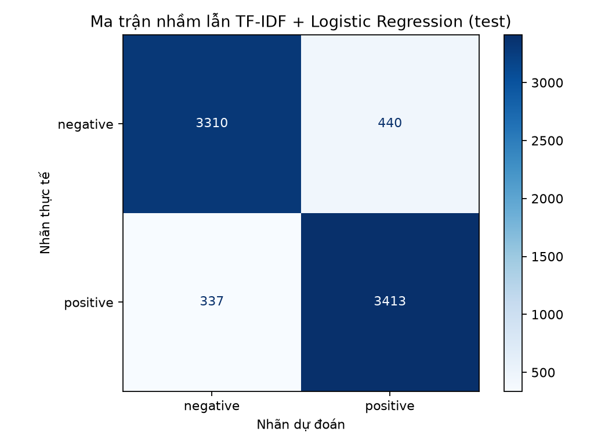

# Báo cáo bằng chứng LAB 04

## 1. Dataset và split

IMDb: 50,000 review; 2 lớp; missing text=0, missing label=0, duplicate ngoài lần đầu=418. Tỷ lệ số mẫu lớp lớn nhất/nhỏ nhất=1.

| Lớp | Số mẫu | Tỷ lệ (%) |
| --- | --- | --- |
| negative | 25000 | 50.0 |
| positive | 25000 | 50.0 |

Độ dài theo token: {'count': 50000, 'average': 231.15694, 'median': 173.0, 'min': 4, 'max': 2470}. Không phải độ dài ký tự.

| Split | Số mẫu | negative | positive |
| --- | --- | --- | --- |
| train | 35000 | 17500 | 17500 |
| validation | 7500 | 3750 | 3750 |
| test | 7500 | 3750 | 3750 |

Overlap duplicate: `{'train_validation': 0, 'train_test': 0, 'validation_test': 0}`. Fit vocabulary/IDF/Word2Vec trên train; seed=42. Chọn model theo validation F1: `tfidf_logistic_unigram_bigram`.

## 2–3. Baseline và so sánh representation

| Model | Split | Accuracy | Precision | Recall | F1 | Vocabulary | Thời gian (s) |
| --- | --- | --- | --- | --- | --- | --- | --- |
| tfidf_logistic_unigram | validation | 0.893600000 | 0.883177570 | 0.907200000 | 0.895027624 | 50000 | 12.515986 |
| tfidf_logistic_unigram | test | 0.896400000 | 0.885803270 | 0.910133333 | 0.897803499 | 50000 | 12.515986 |
| average_word2vec_logistic | validation | 0.869733333 | 0.864197531 | 0.877333333 | 0.870715893 | 58892 | 611.255613 |
| average_word2vec_logistic | test | 0.867733333 | 0.864814815 | 0.871733333 | 0.868260292 | 58892 | 611.255613 |
| tfidf_linear_svm_unigram | validation | 0.898400000 | 0.892331933 | 0.906133333 | 0.899179677 | 50000 | 13.328219 |
| tfidf_linear_svm_unigram | test | 0.896000000 | 0.889355008 | 0.904533333 | 0.896879958 | 50000 | 13.328219 |
| tfidf_logistic_unigram_bigram | validation | 0.906933333 | 0.898017736 | 0.918133333 | 0.907964135 | 100000 | 40.423605 |
| tfidf_logistic_unigram_bigram | test | 0.907066667 | 0.898044329 | 0.918400000 | 0.908108108 | 100000 | 40.423605 |

Lớp positive dùng cho binary Precision/Recall/F1. Thời gian Word2Vec gồm train embedding, tạo vector và fit LR; thời gian TF-IDF gồm fit pipeline. Không coi các thời gian là riêng thời gian classifier.

**Chênh lệch test so với TF-IDF unigram/LR (điểm phần trăm):**

| Model | ΔAccuracy | ΔPrecision | ΔRecall | ΔF1 |
| --- | --- | --- | --- | --- |
| average_word2vec_logistic | -2.866667 | -2.098846 | -3.840000 | -2.954321 |
| tfidf_linear_svm_unigram | -0.040000 | +0.355174 | -0.560000 | -0.092354 |
| tfidf_logistic_unigram_bigram | +1.066667 | +1.224106 | +0.826667 | +1.030461 |

Các chênh lệch mô tả những cấu hình đã chạy; không xác lập nguyên nhân về ngữ nghĩa hoặc khả năng tổng quát cho dataset khác.

## 4. Hai câu demo phủ định

| Câu | Representation | OOV | Prediction | P(positive) |
| --- | --- | --- | --- | --- |
| this movie is good | TF-IDF unigram | [] | positive | 0.804012186121023 |
| this movie is not good | TF-IDF unigram | [] | positive | 0.509973552829790 |
| this movie is good | Average Word2Vec | [] | positive | 0.743084669113159 |
| this movie is not good | Average Word2Vec | [] | negative | 0.249183639883995 |

TF-IDF features và toàn bộ averaged vectors 100 chiều được lưu trong `word_order_demo.json` và notebook. Hai câu thay đổi cả số token và có/không có “not”, không phải hoán vị cùng tập từ; không đủ để chứng minh representation hiểu phủ định hay đo riêng word order.

## 5. Unigram so với unigram + bigram

| Đại lượng | Unigram | Uni + bigram | Chênh lệch |
| --- | --- | --- | --- |
| Vocabulary | 50000 | 100000 | 50000 |
| F1 test | 0.897803498619 | 0.908108108108 | +0.010304609489 |
| Fit time (s) | 12.515986 | 40.423605 | +27.907619 |

Feature bigram thật và coefficients: `{'not good': -1.1059921847827268, 'very good': 1.7498258978386758}`. Cap vocabulary tăng từ 50.000 lên 100.000, nên không quy toàn bộ chênh lệch F1 cho riêng n-gram.

## Evaluation — baseline test

Confusion matrix `[[3310, 440], [337, 3413]]`; hàng true/cột predicted theo negative, positive. TN=3310, FP=440, FN=337, TP=3413; tổng lỗi=777.

| Class | Precision | Recall | F1 | Support |
| --- | --- | --- | --- | --- |
| negative | 0.907595284 | 0.882666667 | 0.894957415 | 3750 |
| positive | 0.885803270 | 0.910133333 | 0.897803499 | 3750 |

